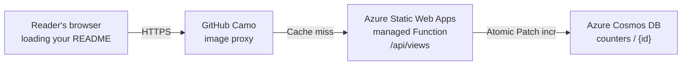

<!-- <div align="center"> -->

# Profile-Counter

> Derived from [othmarodev/profile-counter](https://github.com/othmarodev/profile-counter)

**A self-hosted GitHub profile badge on Azure Static Web Apps and Cosmos DB.**


</div>

`profile-counter` returns an SVG badge and atomically increments its counter each
time a request reaches the Azure Function. Bicep defines the Azure resources, and
GitHub Actions deploys through secretless OIDC authentication.

## Architecture



The deployment uses:

- Azure Static Web Apps Free with a managed Node.js Function API.
- A single-region Cosmos DB for NoSQL account with Free Tier enabled.
- A 400 RU/s shared-throughput database and a 1,000 RU/s account cap.
- An allow-list that prevents callers from creating arbitrary counters.
- A read-only `/api/health` endpoint for monitoring and best-effort warm-up probes.

GitHub Camo is an image proxy: a reader normally downloads the badge from GitHub,
and GitHub requests the Azure URL only when it needs a fresh copy. This hides reader
details from the badge server, but it also means several profile visits can share one
Azure request. The badge therefore counts origin requests, not exact human visits.

## Quick start

1. Review the reusable values in [`infra/deployment.config.json`](infra/deployment.config.json).
2. Install dependencies and check the project:

   ```bash
   npm install
   npm install --prefix api
   npm test
   npm run test:render
   npm run validate:bicep
   ```

3. Commit the files and create the private GitHub repository:

   ```bash
   git add .
   git commit -m "Initial Azure profile counter"
   gh repo create YOUR_REPOSITORY --private --source=. --remote=origin --push
   ```

4. After signing in with `az login` and `gh auth login`, create the Azure-to-GitHub
   trust and repository settings:

   ```bash
   ./scripts/bootstrap-azure.sh
   ```

5. Start the first deployment:

   ```bash
   gh workflow run deploy-azure.yml
   gh run watch
   ```

6. Put the deployed endpoint in a GitHub profile README:

   ```markdown
   
   ```

The bootstrap discovers the GitHub owner, repository, and default branch from the
current remote. No personal GitHub username is stored in the source.

## Retrieve deployment values

After the first successful deployment, list the Static Web App name and hostname:

```bash
az staticwebapp list \
  --resource-group profile-counter-rg \
  --query "[].{Name:name,Hostname:defaultHostname}" \
  --output table
```

Use the hostname to check the managed Function and Cosmos DB without changing the
counter:

```bash
curl -i "https://YOUR_STATIC_WEB_APP.azurestaticapps.net/api/health"
```

A healthy response is `204 No Content` with `X-Health-Status: ok`. An always-on
device or monitoring service can request this endpoint every 10–15 minutes as a
best-effort warm-up probe:

```bash
curl --fail --silent --show-error --output /dev/null \
  "https://YOUR_STATIC_WEB_APP.azurestaticapps.net/api/health"
```

The health endpoint performs a read-only point lookup and never increments the
counter. Do not use `/api/views` as a warm-up probe because it increments the count.
Azure may still recycle the Consumption-style managed Function between requests.

To find the Cosmos DB account name and endpoint:

```bash
az cosmosdb list \
  --resource-group profile-counter-rg \
  --query "[].{Name:name,Endpoint:documentEndpoint}" \
  --output table
```

Retrieve its primary key only when a local `.env` file is needed for counter
administration:

```bash
az cosmosdb keys list \
  --resource-group profile-counter-rg \
  --name "YOUR_COSMOS_ACCOUNT_NAME" \
  --type keys \
  --query primaryMasterKey \
  --output tsv
```

Copy `.env.example` to `.env`, then put the returned endpoint and key in
`COSMOS_ENDPOINT` and `COSMOS_KEY`. Treat the key like a password and never commit
the `.env` file. It is not required for bootstrap, GitHub Actions deployment, or the
hosted badge; it is used by commands such as `npm run seed -- --get` and
`npm run seed -- 100`.

## Documentation

| Guide                                  | Contents                                                                        |
| -------------------------------------- | ------------------------------------------------------------------------------- |
| [Deployment](docs/deployment.md)       | Prerequisites, GitHub OIDC bootstrap, deployment, and verification              |
| [Configuration](docs/configuration.md) | Counter IDs, badge options, data model, and counter administration              |
| [Operations](docs/operations.md)       | Health checks, warm-up probes, cost controls, republishing, and troubleshooting |
| [Development](docs/development.md)     | Local setup, tests, previews, and repository layout                             |

## License

[MIT](LICENSE). The original author's copyright notice is retained.
